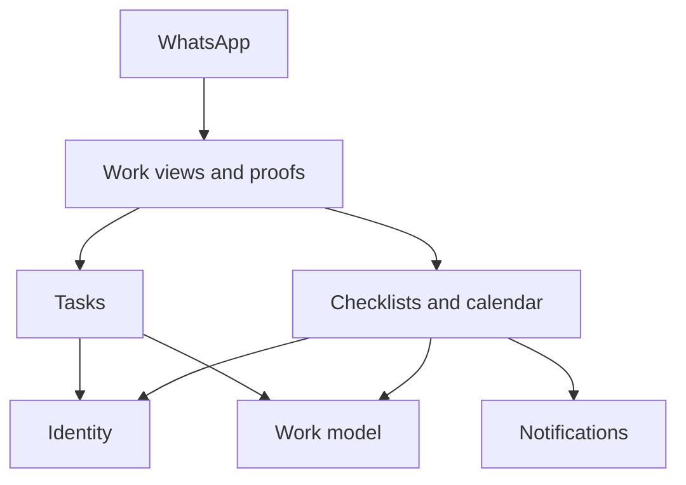

# Delegation App module map

The web app and WhatsApp handlers run in one Next.js deployment and share Supabase. The Expo mobile app is a separate client of the same database and APIs.

Arrows point from a module to a dependency. The diagram omits arrows that can be followed through another module. The table lists the direct dependencies.

| Module | Owns | Direct module dependencies |
| --- | --- | --- |
| `identity` | Sessions, employee directory, roles, employee account operations and credentials | None |
| `notifications` | Inbox, read state and notification delivery to Supabase | None |
| `work-model` | Work-item status, ordering, follow-up rules and query contracts | None |
| `tasks` | One-off task reads and writes, task detail and deletion rules | Identity, Work model |
| `checklists` | Recurring templates, occurrences, completion, Excel import and working-day rules | Identity, Notifications, Work model |
| `work` | Dashboard, work list, MIS, follow-up queries and completion proofs | Checklists, Identity, Tasks, Work model |
| `whatsapp` | Incoming messages, proposals, alerts, transport and ERP report forwarding | Checklists, Identity, Tasks, Work, Work model |
| `fms` | FMS flows from the ERP (Order FMS first): feed sync, step doers and ETAs, WhatsApp alerts to EAs and directors | Checklists, Identity, WhatsApp, Work model |

Next.js pages and API routes in `app/` call the relevant module. Reusable UI lives in `components/`. Modules can import shared infrastructure from `lib/`, which holds Supabase client setup, cookie and cache plumbing, and date helpers. Supabase migrations stay in `supabase/migrations/`.

`npm run lint` checks for circular imports and enforces the allowed module dependencies. Run `graphify update .` to refresh the detailed source graph in `graphify-out/`. Use `graphify query` to trace a specific flow, such as `generateChecklistItems` or `getWorkReport`.
